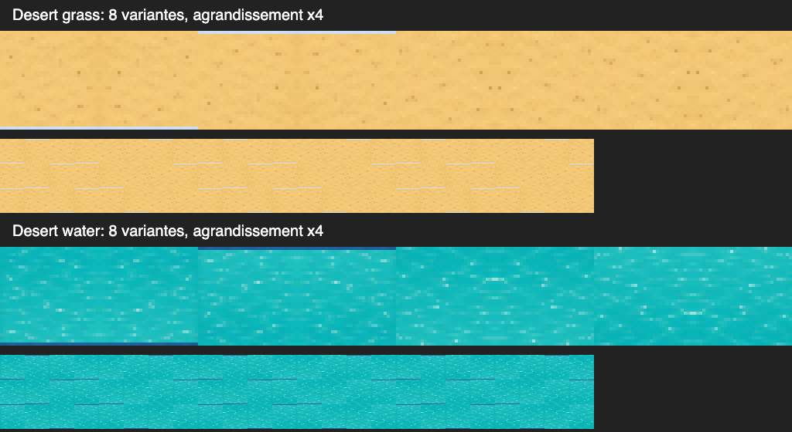

# Audit de fluidité — Les Quatre Couronnes

27 octobre 2026. Version examinée : `06787e5aaaebb5da27d2c61becc3b9fbdbfda124`.

## Conclusion

Le principal frein est la simulation des unités en territoire développé, surtout les recherches de chemins et la sélection des défenseurs. Le nombre d’unités seul explique mal le coût : la disposition, les objectifs et les menaces comptent beaucoup. Réduire encore les cartes ou les populations ne serait pas ma première intervention.

Le rendu bénéficie déjà d’atlas PNG et de caches de terrain et de gazon. Il existe des améliorations utiles côté dessin, mais elles ne résoudront pas à elles seules les saccades mesurées à ×5.

Ce rapport conserve les mesures et recommandations initiales du 27 octobre. Les modifications appliquées le 28 octobre et leur vérification sont résumées ci-dessous ; les données historiques restent inchangées.

## Méthode et limites

- Mac ARM64, macOS 26.5.2, Node 24.22.1 et navigateur intégré de bureau. Aucun téléphone physique, ralentissement artificiel du processeur ou autre navigateur testé.
- Carte 48 × 48. Début de partie, sauvegarde issue d’une simulation naturelle de quatre minutes, et deux charges artificielles de 164 et 600 unités.
- Simulation : trois répétitions de 150 étapes par scénario avec profilage CPU. Les pourcentages sont des échantillons, pas des chronométrages exacts de chaque fonction. Des fonctions s’appellent entre elles : leurs coûts inclusifs ne s’additionnent pas.
- Dessin : canvas natif hors navigateur, 960 × 800, densités 1 et 2 ; 100 appels par condition, avec caches réutilisés puis invalidés. Ce banc peut différer fortement d’un canvas accéléré dans un navigateur, et certains travaux graphiques sont différés. Il sert à comparer les parcours, pas à annoncer des FPS.
- Navigateur : copie locale du code, avec compteurs visibles, mêmes atlas et une sauvegarde de scénario. Instrumentation et contrôles de scénario ajoutés uniquement dans `qa/performance/browser`, aucun service worker installé et aucun accès aux sauvegardes de l’origine publique. Les données évoluent durant les mesures ; comparaison de sessions, pas de frames identiques.
- Le scénario artificiel à 600 unités est un pic de charge : les unités fusionnent rapidement, il ne représente pas 600 unités maintenues durant toute la mesure.
- Les maximums isolés sont sensibles à la compilation, au ramasse-miettes et aux autres activités du poste. Les moyennes et les valeurs à 95 % sont plus utiles.

## Mesures principales

### Simulation hors navigateur

Durée d’une étape du moteur, soit 0,2 seconde de jeu. Le moteur en exécute cinq par seconde à ×1 et vingt-cinq à ×5 si la machine suit.

| Situation | Unités initiales / maisons | Moyenne | 95 % des étapes sous | Maximum |
|---|---:|---:|---:|---:|
| Début | 4 / 11 | 0,21 ms | 0,54 ms | 2,86 ms |
| Partie développée | 209 / 421 | 32,80 ms | 45,76 ms | 113,59 ms |
| Charge artificielle | 164 / 477 | 1,89 ms | 5,22 ms | 13,96 ms |
| Pic artificiel | 600 / 477 | 5,05 ms | 17,01 ms | 63,12 ms |

La partie développée conserve 202 à 235 unités. Les charges artificielles retombent respectivement à 11 et 16 unités : il serait incorrect d’en déduire que 600 unités sont généralement moins coûteuses que 209.

Le benchmark historique de quatre minutes donne une moyenne de 4,84 ms sur la carte 48 × 48, mais cette moyenne mélange le début très peu coûteux et la fin très coûteuse. Mesurer seulement cette moyenne masque le problème de fin de partie.

### Navigateur, partie développée

| Condition | Durée observée | Simulation : moyenne / 95 % | Dessin moyen | Intervalle entre images : moyenne / 95 % |
|---|---:|---:|---:|---:|
| ×1 | 41,0 s | 36,06 / 51,70 ms | 0,74 ms | 18,07 / 33,30 ms |
| ×5 | 28,7 s | 40,17 / 57,60 ms | 2,46 ms | 60,40 / 149,10 ms |
| ×0, même partie ensuite | 47,3 s | simulation arrêtée | 1,15 ms | 16,67 / 17,60 ms |

À ×5, l’intervalle moyen équivaut à environ 17 images/s, avec des pauses perceptibles. À ×1, la moyenne est proche de 55 images/s, mais certaines étapes dépassent toujours le budget d’une image à 60 Hz (16,7 ms). À ×0, le rendu reste proche de 60 Hz.

À ×5, 220 tâches de plus de 50 ms ont été relevées ; à ×1, 28. Pas d’erreur ni d’avertissement console sur ces contrôles. La durée d’une tâche n’est pas identique à la durée de la simulation seule.

### Dessin et sauvegarde

Dans le canvas natif, partie développée : dessin avec caches réutilisés, médiane de 0,72 ms ; avec terrain invalidé à chaque appel, 12,62 ms en densité 1. La condition invalide aussi le gazon via le compteur de déblayage : ce chiffre ne doit pas être attribué au terrain seul. Ce n’est pas une fréquence d’invalidation réelle, mais le coût du chemin lent.

La sérialisation JSON de cette partie fait environ 168 ko et prend 0,46 ms en moyenne. Cela ne mesure pas l’écriture complète dans IndexedDB ou le checkpoint localStorage. La sérialisation n’apparaît cependant pas comme la priorité principale face aux dizaines de millisecondes de simulation répétées.

## Améliorations classées

### 1. Coordonner la défense sans multiplier les recherches de chemins

**Priorité très haute.** Dans le profil de partie développée, `updateDefence` représente environ 48 % du temps échantillonné avec ses appels ; `nextStep` environ 49 % avec ses appels. Ces deux valeurs se recouvrent largement.

À chaque action d’une unité, la défense reconstitue les menaces, parcourt les maisons, trie les candidats, puis vérifie l’accessibilité des cibles et de certains alliés par de nouvelles recherches de chemins. La dernière correction empêche les bâtisseurs de tous poursuivre le même ennemi, mais vérifie encore trop souvent les mêmes trajets.

Proposition : une liste de menaces par royaume et un registre de défenseurs engagés par étape de simulation. Partager les résultats d’accessibilité pour une même cible, position et version de terrain ; utiliser des composantes connexes pour écarter les cibles impossibles avant une recherche détaillée. Mettre à jour les engagements quand une unité meurt, fusionne, reçoit un ordre ou devient trop faible.

Préserver impérativement : défense immédiate contre un ennemi adjacent, priorité du château, exclusion des rois protégés, ordres manuels, renforts réellement capables de rejoindre et de vaincre la cible. Ne pas revenir au comportement où tous les bâtisseurs se détournent vers un même envahisseur.

Une comparaison supplémentaire, sur la même sauvegarde de départ, donne 39,27 ms par étape pour la version actuelle et 35,90 ms avant la dernière correction de défense. Cela indique un surcoût dans ce scénario, sans établir un écart universel de 9 % : ordre de passage, compilation et trajectoires diffèrent au fil de la simulation. Le coût élevé existait déjà avant cette correction.

Sources : `src/engine.ts:2036`, `src/engine.ts:2084`, `src/engine.ts:2094`.

### 2. Partager les chemins et éviter de refaire une recherche complète à chaque pas

**Priorité très haute.** `findStep` alloue deux tableaux de 2 304 entiers à chaque recherche sur une carte 48 × 48. Il est rappelé pour déplacer les unités et pour tester des possibilités.

Un comptage séparé sur 50 étapes de cette partie développée relève en moyenne 82 recherches `findStep` et 313 044 appels `walkable` par étape. Ce comptage ajoute des compteurs dans une copie du moteur ; ses durées ne sont pas utilisées pour comparer les performances.

Un mécanisme de champ de distances partagé existe déjà pour certains ordres de groupe. Sur le benchmark isolé de 1 000 requêtes vers le même objectif : 345,14 ms sans partage, 3,31 ms avec partage. Cela illustre le potentiel de réutilisation ; cela ne signifie pas que tout le jeu sera cent fois plus rapide.

Proposition : étendre ce partage aux poursuites et à la défense compatibles, conserver une route jusqu’à ce que la cible ou un obstacle change, réutiliser les tableaux de travail avec des marqueurs de visite. Les clés doivent distinguer les droits de passage : civil, raid, déblayage permis, barricade cible, etc. Les futurs obstacles indestructibles doivent être inclus dans ces règles et leurs invalidations.

Sources : `src/engine.ts:845`, `src/engine.ts:923`, `src/engine.ts:944`.

### 3. Indexer les maisons, unités et constructions par case

**Priorité haute.** Le choix de travail du joueur (`playerExpansionTarget`) atteint environ 32 % du profil développé, avec ses appels. Une recherche d’emplacement visite beaucoup de cases et interroge fréquemment des listes globales.

`territoryAt` parcourt toutes les maisons pour déterminer le gazon d’une seule case ; `resting` recherche une maison par identifiant ; `structureAt` parcourt les ouvrages ; la défense recherche des maisons proches de chaque menace. Le coût se multiplie avec les recherches de chemins.

Le même comptage relève environ 25 844 appels `canHouse`, 19 759 appels `structureAt` et 2 952 appels `territoryAt` par étape. Ces nombres désignent des vérifications, pas des constructions réelles.

Proposition : tableaux de référence par case, dictionnaires par identifiant, groupes par royaume et carte d’influence partagée. Maintenir ces index lors des constructions, destructions, captures, fusions et chargements. Calculer une fois par étape les agrégats stables comme les effectifs et capacités, en les mettant à jour immédiatement quand une action change leur valeur.

Source : `src/engine.ts:472`, `src/engine.ts:595`, `src/engine.ts:1055`, `src/engine.ts:1623`.

### 4. Conserver les cartes de ravitaillement tant que le terrain utile ne change pas

**Priorité moyenne à haute selon le scénario.** `step` supprime le cache de ravitaillement à chaque étape. Les champs sont alors reconstruits même si les maisons et les passages sont inchangés.

Proposition : invalider lors d’une maison construite, détruite ou capturée, d’un changement de pont/barricade/obstacle ou de l’effondrement d’un château, plutôt qu’au simple passage du temps. Le déplacement d’une unité ne modifie pas le réseau.

Sur les charges artificielles, le ravitaillement est une part notable du profil. Sur la partie développée étudiée, les chemins et la défense restent prioritaires.

Sources : `src/engine.ts:612`, `src/engine.ts:2598`.

### 5. Redessiner les zones modifiées, pas toute la carte

**Priorité moyenne.** Le terrain est déjà un canvas mis en cache. Toutefois, un seul arbre coupé invalide le cache complet, et le gazon dépend aussi du compteur de déblayage.

Proposition : suivre les cases ou petits blocs modifiés, repeindre le terrain local et ses rives voisines, puis les maisons et influences concernées. Séparer les événements qui changent le terrain de ceux qui changent seulement la couleur ou la progression d’un chantier. Éventuellement mettre les maisons stables dans une couche commune.

Également utile : à l’écran titre, en pause ou pendant une sélection immobile, ne redessiner qu’en présence d’un changement visuel, du curseur, d’un déplacement de caméra ou d’une animation encore active. À ×0, le jeu dessine actuellement environ 60 fois par seconde sans simulation : l’intérêt est surtout l’énergie consommée et les machines modestes.

Sources : `src/render.ts:85`, `src/render.ts:352`, `src/render.ts:664`, `src/main.ts:1009`.

### 6. Éviter les longues rafales de simulation dans une image

**Priorité après réduction du coût moteur.** La boucle consomme toutes les étapes accumulées avant de rendre l’image. À ×5, plusieurs étapes de 40 à 50 ms peuvent se succéder dans une même image et retarder le dessin comme les clics.

Proposition : un budget de calcul par image, avec retard conservé et vitesse effectivement atteinte mesurée. Ne pas jeter discrètement du temps ni changer les règles économiques selon les performances. Un worker pourrait ensuite isoler le moteur, mais ajouter des transferts de gros états avant d’optimiser les algorithmes risquerait de déplacer le problème.

La suppression des saccades logiques ne suffit pas non plus à rendre la marche visuellement continue : une interpolation du déplacement entre deux états serait un chantier distinct.

Source : `src/main.ts:1023`.

## Ce qui n’est pas prioritaire

- Remplacer `Math.abs` dans la distance de Manhattan ou introduire une table de racines carrées : le moteur ne calcule déjà pas de racine pour les déplacements. Le coût est surtout le nombre de cases et d’entités examinées.
- Refaire tous les sprites pour accélérer le jeu : les atlas sont déjà chargés et copiés ; le test à ×0 est fluide sur ce poste.
- Réduire immédiatement les 48 × 48 cases ou la limite de population : cela masque les recherches répétées sans les supprimer.
- Réécrire complètement le moteur ou passer directement à WebGL : aucune mesure ne justifie ce changement en premier.
- Réécrire toute l’interface : mise à jour moyenne mesurée à 0,6–0,75 ms, déjà limitée à environ trois fois par seconde. Réutiliser les lignes du DOM serait utile, mais secondaire.

## Défauts visuels et demandes de campagne relevés pendant l’audit

### Sable et eau du désert

Le défaut est visible directement dans les tuiles PNG assemblées, sans le rendu du jeu : bords clairs sur certaines variantes de sable et segments sombres sur celles de l’eau. La répétition et les miroirs propagent ces bandes. Le découpage actuel conserve des marges de la planche source, avec un retrait de 6 % seulement sur quatre des huit variantes. Les rives sont également fabriquées à partir du bord de la même source.

Correction à prévoir : régions de texture propres et raccordables, exclusion systématique des marges parasites, contrôles de répétition des huit variantes dans les cinq biomes à plusieurs zooms ; garder une rive volontaire seulement au contact de la terre. Corriger le découpage si la matière source est saine ; ne régénérer des images que si nécessaire. Le défaut existe avant le rendu, donc changer seulement l’anticrénelage ne suffira pas.

Source : `scripts/pack-imagegen.ts:175`, `scripts/pack-imagegen.ts:220`, `scripts/pack-imagegen.ts:258`.

### Cartes fixes et obstacles permanents

Le comportement actuel ne correspond pas à la demande : `newGame` passe `Date.now()` au générateur, et les cinq scénarios de relief sont répétés dans chaque biome. Les paramètres et densités varient, mais ce ne sont pas 25 géographies conçues individuellement et figées.

Exigence à appliquer : 25 cartes explicites, versionnées et réellement différentes, de 48 × 48, avec des positions initiales stables. Les choix aléatoires de mouvement peuvent rester aléatoires sans modifier la carte. Conserver les sauvegardes des anciennes cartes ; un nouveau départ utilisera la carte fixe correspondante.

Certaines montagnes, notamment en périphérie, seront indestructibles. L’eau pourra aussi former une limite extérieure. Les unités ne pourront généralement pas atteindre le bord. Les rochers déblayables et autres obstacles amovibles resteront distincts, avec leurs coûts et ordres propres. Les passages, contours et grottes devront être validés pour éviter les blocages involontaires.

Sources : `src/engine.ts:188`, `src/engine.ts:219`, `src/main.ts:407`.

### Ponts adverses dispersés

L’observation du joueur est cohérente avec le code : une unité adverse sans cible peut tenter au hasard, à 12 %, une des quatre cases voisines. Il n’y a pas de projet de traversée partagé par royaume. Chaque segment reste bien une case, mais plusieurs unités peuvent financer des débuts de passage parallèles.

Correction à prévoir : choisir une rive accessible et une destination utile de l’autre côté, estimer le nombre de segments et le coût, réserver un trajet de chantier commun, finir les cases successives et réutiliser le passage. Replanifier si une barricade, un ennemi ou une destruction rend le passage inadapté. L’IA ne doit pas bénéficier d’or gratuit ou d’un pont gratuit pour compenser sa mauvaise planification.

Source : `src/engine.ts:2463`.

## Ordre d’intervention recommandé

1. Index par case et par royaume, puis accès et chemins partagés pour la défense, en conservant les comportements récemment corrigés.
2. Cache de ravitaillement et réutilisation des tableaux de recherche.
3. Mises à jour locales du terrain/gazon et arrêt des dessins inutiles en pause.
4. Budget de simulation et, si les nouvelles mesures le justifient, séparation dans un worker.

Les textures, la campagne fixe, les obstacles permanents et la planification des ponts sont des chantiers de qualité visuelle ou de gameplay distincts, à vérifier aussi après toute optimisation. Aucun gain global chiffré n’est promis avant une mesure de la nouvelle version sur les mêmes scénarios.

## Pièces conservées

- `audits/2026-10-27/results.json` : mesures du moteur, du canvas natif et de la sérialisation.
- `audits/2026-10-27/profiles.json` : répartition des échantillons CPU.
- `audits/2026-10-27/browser-x0.json`, `browser-x1.json`, `browser-x5.json` : compteurs visibles relevés dans le navigateur.
- `audits/2026-10-27/calls.json` : comptage des appels sur 50 étapes, dans une copie instrumentée.
- `audits/2026-10-27/comparison.json` : comparaison de la dernière correction de défense.
- `qa/performance/` : scripts, sauvegardes de scénarios, profils CPU bruts et copie de test ; dossier local ignoré par Git.

## Application du 28 octobre 2026

Index des maisons, parcelles, constructions et unités par case ; voisinage des menaces préparé ; composantes accessibles partagées ; champs de chemins réutilisés et tableaux de recherche recyclés. Le ravitaillement est conservé tant que ses dépendances ne changent pas. Le terrain et le gazon sont repeints par cases modifiées. La boucle réserve un budget aux étapes de simulation, conserve son accumulateur et évite les dessins immobiles.

Sur la même sauvegarde développée, une session de bureau de 58,6 s à ×5 mesure 16,51 ms moyens par étape, 0,77 ms par dessin et 16,67 ms entre images (environ 60 images/s), sans tâche de plus de 50 ms relevée. Les 1 464 étapes représentent 292,8 secondes de jeu, soit ×4,997 effectivement atteint. Les durées et trajectoires diffèrent de la session initiale : ce résultat ne garantit pas 60 images/s sur tout appareil ni toute situation. Un worker n’a pas été ajouté : cette mesure ne le justifie pas pour cette version.

La campagne comporte désormais 25 grilles fixes ; les montagnes permanentes et contours bloquent les unités et les monstres ; l’IA conserve un plan de traversée et termine ses ponts successivement. Les nouveaux atlas pixel art Imagegen remplacent les sources précédentes, les sols et eaux ont des bords raccordables et les massifs ont des fragments graphiques répartis sur plusieurs cases. Les tests et limites sont décrits dans VALIDATION.md ; preuves dans audits/2026-10-28/.
