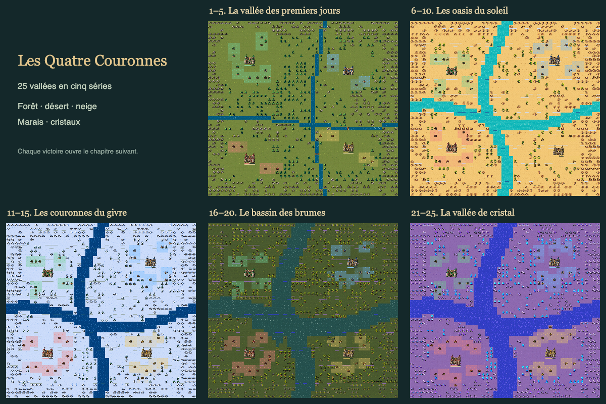
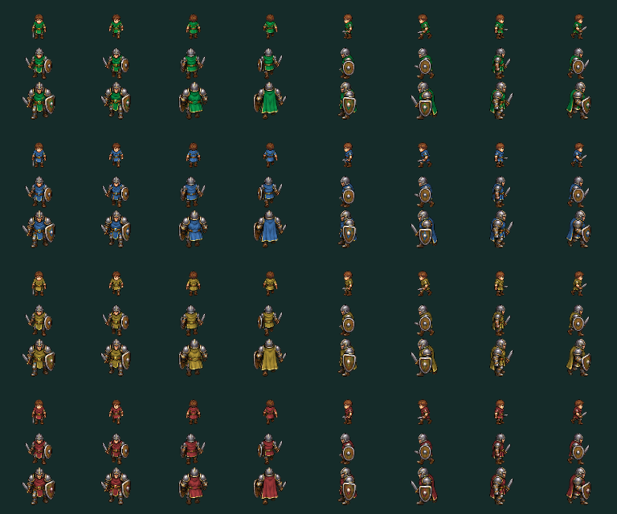
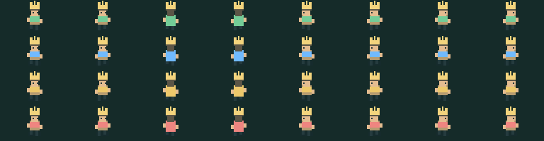

# Les Quatre Couronnes

Un jeu de stratégie autonome en **TypeScript**, Canvas et Vite. Quatre couleurs, les mêmes habitants, des royaumes qui grandissent seuls. Vous incarnez la couronne Émeraude face à trois adversaires, qui peuvent aussi se détruire entre eux.

**Jouer en local :** `pnpm dev`. Le dossier `docs/` est prêt pour une activation de GitHub Pages lors de la publication publique.

## Une vallée vivante

La première carte contient 80 × 80 petites cases, sans quadrillage visible : terre, sapins, rochers, montagnes et rivières. Chaque camp commence avec **5 000 pièces**, un château de **3 × 3 cases**, un roi de **100 PV** et des maisons espacées. Le premier chapitre donne **cinq maisons au joueur et deux à chacun de ses adversaires**, avec des bras de rivière d’une case de large. À partir du deuxième chapitre, chaque camp reçoit quatre maisons. Cinq chapitres proposent des cartes de 80 à 96 cases de côté et une production adverse progressivement accélérée. Les thèmes se succèdent : forêt et montagne, désert avec palmiers et cactus, terres enneigées, marais à cyprès, puis forêt de cristal. Les chapitres se débloquent uniquement après la victoire du précédent.

Chaque maison produit régulièrement une unité de 100 PV. Les habitants choisissent seuls leurs déplacements. Une terre libre et suffisamment éloignée des autres maisons les encourage à fonder rapidement une nouvelle maison. Pour le joueur, les seules initiatives de développement sont la construction de maisons et la coupe des arbres. En cas d’invasion près des maisons ou du château, les habitants proches défendent automatiquement leur territoire, puis reprennent leur activité. Un ordre manuel interrompt cette défense et reste prioritaire ; le roi ne sort pas seul. Déblayer les rochers, lancer une offensive, capturer des maisons et construire les autres éléments exige un ordre. L’errance, les fusions au contact et la défense restent les règles de la simulation. Les adversaires prennent leurs propres initiatives. On peut observer toute la partie ou intervenir.

## Les règles

- **Maisons :** 100 pièces. Deux maisons ne peuvent jamais être voisines, même en diagonale. Fonder une maison transforme l’habitant en bâtiment.
- **Travail :** couper un arbre coûte 2 pièces et rapporte 5 bois ; dégager un rocher coûte 3 pièces et rapporte 4 pierres. L’unité perd 3 PV. Si l’or manque, l’action attend.
- **Territoire :** trois secondes après la fondation, les huit cases de terre voisines reçoivent progressivement un gazon de la couleur du camp. Les zones voisines forment une masse continue, sans quadrillage.
- **Vie :** un habitant perd 0,12 PV par seconde et 0,32 PV par déplacement. Avec l’ordre **Tenir**, immobile sur une maison alliée, il ne perd plus de PV avec le temps. Quand le secteur accessible n’offre plus de travail, ou quand l’or manque, les habitants rejoignent seuls les maisons, sans fusion forcée durant ce repos. Un nouveau passage ou du travail accessible les réveille.
- **Fusion :** durant les déplacements ordinaires, les vies de deux alliés s’additionnent exactement. Les unités qui rejoignent leur roi fusionnent avec lui, et le roi conserve son identité.
- **Combat :** l’attaquant paie 1 pièce. Entre unités ordinaires, la plus forte gagne ; elle perd 70 % des PV du vaincu. À égalité, les deux meurent. La défense ne coûte pas d’or.
- **Gabarits :** habitant sous 1 000 PV, guerrier de 1 000 à 10 000 PV inclus, colosse au-delà de 10 000 PV. Quatre directions et deux poses de marche, dans les quatre couleurs. Le roi possède sa couronne dans chacune de ses directions.
- **Pont :** 1 000 pièces au premier chantier, 500 pièces pour reconstruire au même endroit, plus 4 bois par case d’eau. 1 000 PV. Le pont traverse complètement un bras de rivière de six cases au maximum. Un ennemi doit le combattre avant de passer ; sa destruction rétablit l’eau et fait tomber les unités présentes. Le joueur ne construit jamais un pont sans ordre.
- **Barricade :** 750 pièces, 12 bois, 1 500 PV. Elle bloque une case de terre. Les unités cherchent un détour ; un ordre vers une barricade ennemie permet de l’attaquer et de la détruire.
- **Barrage :** 32 pièces, 12 pierres et 4 bois par case. Il est infranchissable et rapporte 0,2 pièce par seconde et par case. Cette première version ne simule pas les crues ni les changements du niveau de l’eau.
- **Impôts :** de 0 à 30 %. Les revenus augmentent avec le taux, tandis que l’intervalle entre naissances passe de 10 à 31,6 secondes par maison. L’ajustement automatique prend en compte le trésor et la population. Les quatre camps ont les mêmes coûts ; les chapitres avancés accélèrent les naissances adverses.

## Le roi

Le roi est une unité sélectionnable et mobile. Sa force est sa réserve personnelle, initialement de 100 PV, **augmentée de 25 % des PV de ses autres unités**. Les PV totaux du royaume, roi compris, sont affichés à côté de l’or. La formule évite qu’un roi augmente récursivement sa propre force.

Dans les neuf cases de son château, sa puissance de combat défensive est **multipliée par quatre**. Un assaillant un peu plus fort que lui ne suffit donc pas. Hors du château, le roi perd **5 % de ses PV par seconde**, avec un minimum de 4 PV/s. Revenir arrête cette perte ; cela ne soigne pas les dégâts. Tenir immobile sur une maison alliée permet aussi de s’abriter, sans le bonus défensif du château.

Le roi peut raser les maisons ennemies en les traversant, au prix de 8 PV par maison. Les habitants ordinaires peuvent capturer une maison sans défense proche. Un bouton **Rentrer** rappelle le roi dans son château.

Un royaume disparaît lorsque son roi meurt **ou lorsqu’il n’a plus aucune maison et aucun habitant ordinaire**. Un roi seul ne suffit pas à maintenir son royaume. Son château s’effondre et laisse des ruines. La partie est gagnée lorsque les trois autres royaumes ont disparu ; elle est perdue dès l’élimination du joueur.

## Commandes et sauvegarde

- Clic sur un habitant vert ; glisser pour une sélection multiple ; Maj pour ajouter à la sélection. Le roi se sélectionne seul, uniquement par clic direct. Les rectangles et la touche A l’excluent ; Voir le roi recentre seulement la vue. Un petit menu d’ordres apparaît sur la carte.
- Choisir un ordre puis sa destination : déplacer, fusionner, maison, pont, barrage, barricade. Déplacer sur une cible ennemie ordonne une attaque ; sur un rocher, le déblaiement. Les constructions nécessitent un habitant ordinaire.
- L’option **Épargner pour un chantier** réserve 1 000 pièces contre les fondations automatiques, afin de pouvoir financer une infrastructure. Les ponts et barricades désactivent cette épargne après leur construction.
- **Tenir** immobilise les unités. **Autonomie** leur rend leurs choix.
- Molette ou boutons +/− pour zoomer ; clic droit glissé ou Alt + glisser pour déplacer la carte. Sur écran tactile, le bouton ↔ active le déplacement de la carte.
- Espace : pause ; F : fusion ; A : sélectionner tout ; Échap : annuler. Vitesses ×1, ×2, ×4, ×8 et ×16. Une nouvelle partie démarre à ×1.
- Un clic sur le titre en haut à gauche demande confirmation, sauvegarde la partie et revient à l’écran titre. Le texte de l’interface ne se sélectionne pas pendant les gestes.
- Écran titre **New game / Load game**. Sauvegarde locale automatique toutes les 10 secondes, bouton manuel, export et import JSON au menu. La reprise se fait en pause. Le hasard, les ordres, les ressources, les rois et les ruines sont conservés.
- La partie ne progresse pas lorsque son onglet est masqué. Aucune progression hors ligne n’est calculée. Le stockage dépend du navigateur et de l’adresse utilisée ; l’export permet de transférer une sauvegarde.

## Développer

Node.js 24 et pnpm 11.25.0.

```sh
pnpm install --frozen-lockfile
pnpm dev
pnpm test
pnpm build
pnpm sprites
pnpm biomes
pnpm simulate
```

`src/engine.ts` contient la simulation déterministe, `src/render.ts` les sprites et la carte, `src/main.ts` l’interface et la sauvegarde. `pnpm build` vérifie les types et produit `docs/`, prêt pour GitHub Pages. Les sprites sont dessinés par le code du jeu ; les deux planches PNG sont des exports de référence régénérables, sans asset emprunté.

La limite est de 150 unités simultanées par camp, roi compris. Cette première version est destinée à être équilibrée par les parties réelles : vitesse d’expansion, coûts, usure et protection royale sont centralisés dans le moteur.

## Les cinq thèmes



## Planches des sprites

Les lignes des habitants correspondent aux quatre camps, avec trois gabarits par camp ; les colonnes montrent face, dos, gauche et droite, chacune en deux poses.




