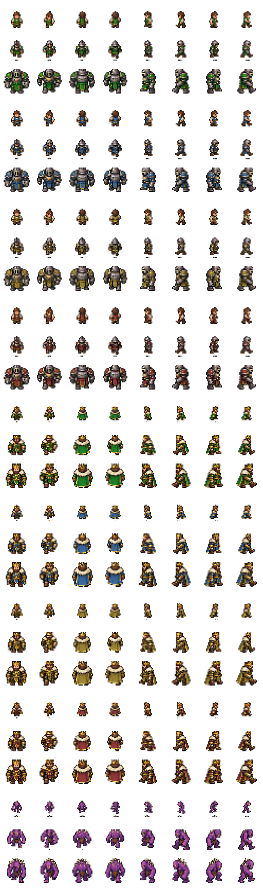

# Les Quatre Couronnes

**[Jouer dans le navigateur](https://girianshiido.github.io/les-quatre-couronnes/)**

Jeu de stratégie autonome en TypeScript et Canvas : quatre royaumes identiques, distingués par leur couleur, et un monde qui continue de vivre sans vos ordres. Vous incarnez la couronne Émeraude face à trois adversaires qui peuvent aussi se combattre entre eux.

## La campagne

**25 niveaux en cinq séries** : forêt et montagne, désert, neige, marais, forêt de cristal. Chaque victoire débloque le niveau suivant. Les 25 cartes sont fixes, enregistrées case par case et différentes : départs décalés, rivières, îlots, gorges et clairières. Une nouvelle partie retrouve toujours la même géographie. Certaines cartes proposent des grottes facultatives.

Toutes les nouvelles cartes font **48 × 48 cases**, sans quadrillage visible. Tous les camps commencent avec **5 000 or**, un château de neuf cases et un roi de 100 PV. Le premier niveau donne **cinq maisons au joueur et deux à chaque adversaire**, avec des cours d’eau d’une case de large. Son bassin est plus vaste et isolé, tandis que deux ponts déjà achevés relient les trois adversaires entre eux. Ensuite le joueur en reçoit quatre ; les adversaires quatre à six selon la série. Les règles et les impôts s’appliquent de façon identique aux quatre camps.


## Habitants, vie et territoire

Les habitants naissent à **100 PV**. Ils cherchent des tâches accessibles suivant votre doctrine : maisons, destruction des maisons adverses ou coupe d’arbres. Une maison ne peut jamais toucher une autre maison, même en diagonale. Les autres travaux et les assauts directs contre les rois demandent un ordre. Les massifs rocheux raccordés et les contours permanents sont indestructibles ; les petits rochers isolés restent déblayables. En cas d’invasion, les habitants proches des maisons ou du château défendent leur territoire ; un ordre manuel reste prioritaire.

- **Fusion :** deux alliés qui se rencontrent additionnent leurs PV. Sur toute case, y compris une maison, les alliés fusionnent obligatoirement. S’abriter sur la même maison rassemble donc aussi les unités. Les unités qui rejoignent leur roi fusionnent avec lui.
- **Combat :** entre unités ordinaires, la plus forte gagne et perd 70 % des PV du vaincu. À égalité, les deux meurent. Les combats et destructions ne coûtent pas d’or.
- **Usure :** la marche et le temps consomment des PV, même dans son propre camp. L’usure temporelle augmente avec la distance au roi et avec la taille d’une grosse unité. Sur une maison alliée, l’usure normale s’arrête, quel que soit l’ordre.
- **Repos :** quand aucun travail accessible ne reste, ou quand l’or manque, les habitants attendent sur les maisons et fusionnent avec tout allié qui les rejoint. Un passage ouvert ou du nouveau travail les remet en activité.
- **Entretien :** au-delà de 500 PV, une unité ordinaire consomme **2 or par seconde pour 1 000 PV**, jusqu’à trois fois ce coût loin des maisons. Si le trésor ne suffit pas, la part non financée provoque une perte pouvant atteindre **3 % de ses PV par seconde**, même sur une maison. Le roi et les monstres n’ont pas cet entretien financier.
- **Gabarits :** habitant sous 1 000 PV, guerrier de 1 000 à 10 000 inclus, colosse au-delà. Quatre directions, deux poses de marche et quatre couleurs, avec une couronne pour le roi.
- **Gazon :** il apparaît progressivement dans les huit cases autour des maisons. Détruire le gazon ennemi coûte **2 PV + 0,2 % des PV actuels par case** ; raser une maison coûte **200 PV + 5 % des PV actuels**, pour les habitants, le roi et les monstres. Aucune dépense d’or. Une autre maison peut réétendre son gazon sur le terrain.

## L’or et les constructions

| Action                                     |                     Prix |
| ------------------------------------------ | -----------------------: |
| Maison                                     | 150 or et jusqu’à 100 PV |
| Couper un arbre                            |            30 or et 3 PV |
| Dégager un rocher                          |             15 or et 3 PV |
| Une case de pont                           |                 1 000 or |
| Reconstruire cette même case de pont       |                   500 or |
| Barricade                                  |                   750 or |
| Transformer un pont allié libre en barrage |                    32 or |

**Un ordre de pont construit exactement une case**, avec 1 000 PV. Une rivière plus large exige plusieurs ordres. Tous les camps peuvent traverser un pont ouvert ; l’ordre Attaquer permet de le détruire. Sa destruction rétablit l’eau et fait tomber les habitants qui s’y trouvent. Les anciens ponts de sauvegardes sont conservés sous forme de tronçons indépendants.

Les barricades ont 1 500 PV et bloquent la route. Les unités peuvent les contourner ou les attaquer. Les barrages sont infranchissables et rapportent 0,2 or par seconde lorsque le taux est supérieur à 0 % ; cette version ne simule pas les crues.

**Impôts :** 0 % donne une naissance toutes les **6 secondes par maison**, 24 % environ toutes les **117 secondes**, 30 % toutes les **180 secondes**. Le taux augmente les revenus mais ralentit fortement les naissances, pour le joueur comme pour les adversaires. Changer le taux conserve la progression du cycle et ne libère pas de stock caché. L’automatisme ajuste le taux selon le trésor, la population et les besoins. L’option Épargner pour un chantier réserve 1 000 pièces contre les fondations automatiques.

## Le roi et la victoire

Le roi commence à 100 PV. Sa force est sa réserve personnelle augmentée de **50 PV par maison au-delà des maisons de départ** et de **25 % des PV de ses autres unités**, avec un **plafond de 100 PV par maison restante**, duquel sont retranchées ses blessures. Les blessures ne disparaissent pas lorsqu’il atteint le plafond, rentre au château ou recharge une sauvegarde. Les unités qui le rejoignent lui transmettent leurs vies. Dans les neuf cases de son château, sa force défensive est multipliée par **huit**, avec **2 000 PV de remparts** qui s’usent lors des assauts.

Dehors, le roi perd **5 % de ses PV par seconde**, au minimum 4 PV/s. Rentrer au château ou s’abriter sur une maison arrête cette usure sans soigner les dégâts. Avancer le roi peut soutenir les soldats proches, mais le rend vulnérable.

Un royaume disparaît si son roi meurt **ou dès qu’il perd sa dernière maison**, même si son roi et ses armées ont encore des PV. Son château s’effondre et laisse des ruines. La partie est gagnée lorsque les trois royaumes adverses ont disparu.

## Les grottes

Seulement certains niveaux contiennent des grottes. Leurs monstres ne gagnent pas d’argent, ne paient pas d’entretien et ne perdent pas de PV avec le temps ou la marche. Ils fusionnent et deviennent de plus en plus forts si on les laisse s’accumuler. Ils perdent des vies au combat et lorsqu’ils détruisent du gazon ou des maisons.

Ils commencent dans des zones fermées par l’eau ou une barricade. **Ouvrir un pont ou détruire une barricade peut les libérer vers les autres camps.** Détruire une grotte arrête les nouvelles sorties mais ne supprime pas les monstres existants. Les éliminer n’est pas une condition de victoire.

## Commandes et sauvegarde

1. Cliquez une unité verte ou tracez un rectangle. **Toute la simulation s’arrête.** Le roi est toujours ignoré par les rectangles ; un clic direct permet de le sélectionner seul.
2. Cliquez une destination. Les actions proposées dépendent de la case : eau accessible → seulement un pont ; maison alliée → abri ; arbre → coupe ; ennemi → attaque ; terre libre → déplacement, maison, barricade ou rassemblement.
3. Choisissez l’action pour reprendre la simulation. Échap ou Annuler retire la sélection. La pause manuelle reste prioritaire.

Molette ou +/− : zoom ; clic droit ou Alt + glisser : déplacer la carte. Le bouton ↔ permet le déplacement tactile. A sélectionne les habitants sans le roi. Curseur de vitesse **de 0 à ×5**, par pas de 0,25 (0 met le jeu en pause) ; une nouvelle partie démarre à ×1.

Un clic sur le titre en haut à gauche demande confirmation, sauvegarde et revient à **New game / Load game**. Le texte ne se sélectionne pas pendant les gestes. Une sauvegarde automatique distincte est conservée pour chaque partie. Le bouton Sauver crée des copies nommées indépendantes ; Load game ouvre une bibliothèque avec recherche, chargement, renommage et suppression. Le jeu n’impose aucune limite de nombre (dans la capacité de stockage du navigateur). Export/import JSON au menu. La reprise se fait en pause. Les anciennes sauvegardes conservent leur carte complète et migrent vers la nouvelle campagne.

Le jeu ne progresse pas lorsque son onglet est masqué. Le stockage dépend du navigateur et de l’adresse utilisée ; l’export permet de transférer une sauvegarde. Limites : 150 unités simultanées par camp, roi compris, et 100 monstres.

## Développer

Node.js 24 et pnpm 11.25.0.

```sh
pnpm install --frozen-lockfile
pnpm dev
pnpm test
pnpm build
pnpm sprites
pnpm biomes
pnpm simulate
```

`src/engine.ts` : simulation déterministe et économie ; `src/monsters.ts` : grottes et monstres ; `src/orders.ts` et `src/selection.ts` : commandes ; `src/render.ts` : carte et copies des atlas PNG ; `src/atlas.ts` : repères et chargement des images ; `src/saves.ts` : bibliothèque IndexedDB ; `src/main.ts` : interface et sauvegarde. Le build vérifie les types et produit `docs/` pour GitHub Pages. Les trajets des grandes formations sont partagés et les éléments hors champ ne sont pas dessinés. Voir `VALIDATION.md` pour les essais et leurs limites.

Les personnages, bâtiments et cinq biomes ont été créés avec **Imagegen**. Les sources et leurs consignes sont conservées dans `art-source/imagegen/` (voir `PROMPTS.md`). Les fichiers `public/art/actors.png`, `world.png` et `buildings.png` sont assemblés à l’avance à partir de ces sources par `pnpm sprites`, puis copiés dans le build et le cache hors connexion. 216 images d’habitants, rois et monstres couvrent quatre directions, deux poses et trois gabarits. Les quatre camps partagent les mêmes silhouettes, recolorées. Les cinq biomes possèdent leurs terrains et variantes. Le rendu copie ces images et conserve le cache de terrain. Maisons, grottes et chantiers tiennent dans une seule case, ombres comprises ; le château conserve ses neuf cases. Un rendu de secours reste disponible si les fichiers ne peuvent pas charger.



### Expansion et ordres de groupe

Sans ordre explicite, chaque habitant cherche une parcelle libre accessible à proximité, puis au-delà des passages ouverts, pour y construire une maison. Les arbres peuvent être défrichés ; la destruction des maisons adverses suit désormais votre doctrine réordonnable. Les habitants de moins de 42 PV préfèrent attendre sur une maison. Les parcelles visées sont réparties entre les habitants pour limiter les regroupements inutiles.

Une fusion conserve la mission de déplacement ou d’attaque en cours, sans entraîner le roi. Les attaques traversent les ponts du trajet ; elles ne détruisent un pont que lorsqu’il est lui-même la cible de l’ordre. Un ordre temporairement inaccessible reste en attente et reprend dès qu’un passage s’ouvre. Les chemins dégagés sont privilégiés avant ceux qui nécessitent un défrichage.

### Doctrine et installation

Le mode Personnalisée contient trois priorités réordonnables avec les boutons ↑ et ↓ : construire sur terrain libre, détruire les maisons adverses, couper les arbres. Le premier travail réalisable dans le voisinage est privilégié ; à défaut, la recherche s’élargit. L’abri sur une maison reste le recours lorsqu’il n’y a pas de travail ; sous 42 PV, le repos prime. Un changement de doctrine réoriente les unités autonomes immédiatement, sans interrompre les ordres manuels. La doctrine est conservée avec la sauvegarde et lors du passage à une autre vallée. Après un déplacement, les habitants reprennent leur activité ; seuls le roi et l’ordre explicite Tenir restent immobiles.

Le bouton Installer le jeu figure sur l’écran titre et dans l’en-tête. Dans un navigateur compatible, il déclenche l’installation ; sinon, il indique comment installer depuis le navigateur. Une fois installé, il devient ↻ et recherche les mises à jour. Une pastille dorée annonce une version prête. Le jeu sauvegarde la partie avant d’activer cette version et de recharger. Le manifeste et le service worker gardent les fichiers du jeu disponibles hors connexion après un premier chargement réussi. Les sauvegardes restent locales au navigateur utilisé.

### Profils stratégiques

Le sélecteur propose quatre doctrines : **Bâtisseur** favorise les fondations, y compris avec les unités fusionnées, et économise pour les maisons ; **Conquérant** donne davantage d’initiatives offensives aux grosses unités en conservant du développement ; **Gardien** poste la plupart des troupes d’au moins 500 PV près des ponts ou de la frontière et réserve 750 or ; **Prudent** garde 1 000 or et abrite les habitants sous 70 PV. Les profils donnent des tendances pondérées, avec une part de hasard et des choix locaux. En mode Bâtisseur, les unités de plus de 1 000 PV conservent leur préférence pour les fondations ; les autres profils peuvent les orienter vers le combat. Le mode **Personnalisée** conserve la liste de priorités réordonnable.

Construire en priorité implique aussi d’épargner : si une parcelle libre est accessible, une coupe de moindre priorité ne doit pas absorber chaque rentrée de 30 or et empêcher d’atteindre les 150 or nécessaires. Les commandes manuelles peuvent utiliser la réserve et gardent la priorité. Les prix de construction restent inchangés.

Les quatre royaumes défendent désormais leurs maisons et leur château. Les unités d’au moins 1 000 PV peuvent réagir à une invasion distante ; une menace près du château prime sur un petit ennemi en bordure. Elles cherchent une cible accessible qu’elles peuvent vaincre. Si des alliés capables de rejoindre une menace sont déjà assez forts pour l’intercepter, les autres habitants poursuivent leur développement. Un ennemi adjacent reste une urgence locale ; plusieurs envahisseurs peuvent mobiliser des défenseurs différents. Un roi protégé dans son propre château n’est pas considéré comme un envahisseur. Les ordres manuels, dont Tenir, ne sont pas annulés.

Une mise à jour disponible ouvre maintenant une confirmation en cours de partie : « Sauvegarder et mettre à jour » ou « Annuler ». Sans validation, le jeu ne recharge pas.

### Recommencer et capturer un royaume

Le bouton **↶ Recommencer le niveau** est accessible en cours de partie dans l’en-tête, ainsi que depuis le menu. La confirmation remet la même carte à zéro avec les conditions initiales, sans attendre une défaite. La doctrine et les niveaux débloqués sont conservés ; une nouvelle sauvegarde automatique est créée et la précédente est conservée.

Quand une unité élimine un roi adverse, **toutes les maisons de ce roi passent immédiatement au vainqueur**. Leur production, leur position et leur cycle de naissance sont conservés ; les maisons et leur gazon prennent la nouvelle couleur. Cela fonctionne entre les quatre royaumes, y compris lorsqu’un roi meurt dans un assaut raté. Le château vaincu s’effondre et les unités du camp éliminé disparaissent. Les monstres, les morts naturelles et les combats sans survivant ne donnent pas de royaume bénéficiaire.

### Expansion des armées adverses

Les grosses unités adverses choisissent des objectifs accessibles : elles construisent sur les terrains libres proches si leur trésor le permet, puis rasent les maisons adverses qui bloquent leur développement. Elles poursuivent cette expansion de parcelle en parcelle au lieu de tourner autour du château ennemi. Les petites unités continuent de développer leur camp. Une menace proche de leur propre château interrompt l’expansion ; une escarmouche éloignée ne détourne plus automatiquement toute une armée.

Une fondation coûte **150 or et jusqu’à 100 PV du bâtisseur**. Un habitant à 100 PV ou moins y consacre ses vies restantes ; une unité fusionnée garde le surplus et peut construire plusieurs maisons. La règle vaut pour le joueur, les adversaires et les ordres manuels. Les naissances restent à 100 PV.

Un adversaire peut saisir une occasion locale de prendre le roi : il doit être tout proche, disposer d’une grande marge face à sa défense complète et avoir un trajet immédiat dégagé. Un roi trop fort, un cours d’eau fermé ou une garnison dangereuse ne sont pas des cibles de raid ordinaires. Les ponts traversés restent intacts ; les maisons et le gazon détruits coûtent des PV, sans dépense d’or.

## Maisons et soutien des armées

Chaque maison soutient **200 PV d’armée ordinaire**. Ce total est commun à toutes les unités du camp : fractionner une armée ne crée pas de capacité supplémentaire. La part non soutenue perd **4 % de ses PV par seconde** (par exemple, 3 000 PV pour 2 000 soutenus perdent 40 PV/s au départ), même à l’abri sur une maison. Ce soutien ne soigne pas les dégâts et ne constitue pas une limite dure empêchant les naissances.

Hors d’une maison, l’éloignement des maisons alliées ajoute **0,3 % des PV par seconde pour chaque case au-delà de quatre**, jusqu’à **6 %/s**. La distance suit les chemins ouverts : une rivière fermée, un rocher, un arbre, une grotte, une barricade ou un château adverse ne ravitaille pas au travers. Un pont ouvert prolonge le réseau. Construire des relais sur l’avancée réduit donc les pertes locales et augmente la capacité totale. Ces pertes s’ajoutent à l’usure habituelle et, le cas échéant, au manque d’or.

Au-delà de 500 PV par unité, l’entretien coûte **2 or/s pour 1 000 PV**, multiplié progressivement jusqu’à **trois** loin des maisons. Les revenus restent proportionnels aux maisons et aux impôts : `maisons × taux × 0,07 + cases de barrage × 0,2` (strictement zéro si le taux est nul) or/s. Dix maisons à 24 % rapportent **16,8 or/s**, alors qu’une armée de 3 000 PV demande **6 à 18 or/s**. Un gros trésor permet de payer temporairement cet entretien, mais ne supprime ni le manque de maisons ni l’éloignement.

Les règles de soutien, de destruction, d’entretien et d’effondrement sont identiques pour les quatre royaumes. Les monstres conservent leur absence d’économie et d’usure naturelle ; ils paient le même coût de destruction en PV. Les sauvegardes existantes restent lisibles et appliquent les nouvelles règles à la reprise.

À 0 %, aucune rentrée d’or ne subsiste, y compris les barrages. Les habitants naissent toujours toutes les six secondes ; les constructions et les grosses unités puisent dans les réserves. Avec 50 maisons, les revenus sont de **35 or/s à 10 %**, **70 or/s à 20 %**, **84 or/s à 24 %** et **105 or/s à 30 %**. Le barème est linéaire à tous les taux ; 24 % n’est pas un palier particulier. Les naissances restent progressivement ralenties jusqu’à 180 secondes à 30 %.

En mode Bâtisseur, les grandes unités continuent les fondations. Une fondation choisie est exécutée à l’arrivée sans nouveau tirage au sort. Si l’argent manque, les bâtisseurs restent sur leur maison ou rejoignent un abri proche, plutôt que de partir pour un raid lointain ou de changer continuellement d’abri ; ils repartent lorsque le budget permet un chantier. Les autres doctrines conservent leurs choix et les ordres manuels restent prioritaires.

Un ordre **Fusionner** attend tous les participants encore vivants et affectés à cet ordre, puis rend la main à la doctrine, au point de rassemblement. Le groupe est conservé dans la sauvegarde ; les anciennes sauvegardes restent compatibles. Les unités déjà réunies sur une maison fusionnent aussi. Les morts et les participants ayant reçu un autre ordre ne bloquent pas la reprise.

## Affichage des unités et chantiers progressifs

Les chiffres au-dessus des habitants, rois et monstres sont masqués par défaut, même en sélection. Le survol affiche leurs PV exacts dans une infobulle dont la taille reste lisible au dézoom. Dans le menu, **Toujours afficher les PV des unités** active les nombres permanents ; le choix est mémorisé dans le navigateur et peut être désactivé.

Un pont ou une barricade peut être commandé sans disposer de 1 000 ou 750 or. L’ouvrier rejoint une berge ou une case voisine et verse l’or disponible, puis les rentrées suivantes. Le chantier conserve sa progression et les dépenses si l’ouvrier meurt ou change d’ordre ; un autre habitant du même royaume peut le terminer en payant seulement le reste. À 0 % d’impôts et sans réserve, le chantier attend. L’usure et l’entretien habituels continuent ; une maison protège de l’usure normale.

Les échafaudages montrent les chantiers et leur progression. Le pont reste une case d’eau infranchissable jusqu’à son achèvement ; la barricade ne bloque le passage qu’une fois achevée. Les chantiers peuvent être détruits et les dégâts reçus ne sont pas effacés par l’achèvement. Un chantier de pont abandonné avant son premier achèvement ne crée pas de réduction : la reconstruction à 500 or reste réservée aux ponts déjà achevés puis détruits. Sauvegarde, reprise et export conservent les paiements.

## Une première vallée favorable au vert

La génération du niveau 1 réserve au vert un bassin du nord-ouest plus vaste, un espace de départ un peu plus dégagé et des forêts défrichables plutôt que des obstacles rocheux intérieurs. Les montagnes restent présentes en bordure. Les trois autres royaumes disposent de deux ponts d’une case, déjà achevés, et de chemins dégagés entre leurs châteaux ; aucune de ces liaisons n’ouvre le territoire vert. Tous commencent toujours avec 5 000 or et un roi de 100 PV, avec cinq maisons pour le vert contre deux par adversaire.

Sur cette première carte, une IA qui dispose encore d’un ennemi accessible par les liaisons existantes ne commence pas un nouveau pont. Le vert peut ouvrir lui-même un passage lorsqu’il est prêt ; le dernier adversaire peut ensuite chercher à le rejoindre. Les autres niveaux conservent leur génération et leur comportement antérieurs. Les sauvegardes chargées gardent leur géographie : une nouvelle partie ou un redémarrage de la première carte applique le nouveau tracé.

Le **clic droit simple** annule la sélection et les actions en préparation. Il libère la pause de planification, en conservant une éventuelle pause manuelle. Le clic droit glissé continue de déplacer la carte.

Les ordres de construction sont transmis à **tous les habitants sélectionnés**. Chacun part immédiatement vers la destination, ou vers une case de travail adjacente pour pont/barricade/barrage. Les alliés qui se rencontrent fusionnent, y compris sur une maison servant de poste de chantier. Les retardataires poursuivent leur approche même si la construction a déjà été achevée. Les personnages ne sont pas téléportés et les obstacles restent pris en compte. La sélection conserve uniquement les auras, sans lignes pointillées ; le titre de la carte et le message de planification sont compacts.

## Ordres en continu et cartes compactes

Après sélection d’habitants et clic sur une case, le menu propose **Construire des maisons en continu**, **Déblayer les obstacles en continu** et **Détruire les barricades en continu**, selon le terrain. Les habitants choisissent les tâches accessibles les plus proches et enchaînent sur toute la carte. Le bâtisseur peut combattre et raser les maisons adverses au cours de son expansion. Le déblayage traite les arbres et les rochers (ou leurs équivalents des autres biomes), sans fonder de maisons. La démolition traite les barricades, y compris les chantiers et les barricades alliées, sans construire de ponts ni déblayer un autre type d’obstacle.

Les coûts restent inchangés : 150 or et jusqu’à 100 PV par maison ; 30 or par arbre, 15 par rocher ; les destructions coûtent des PV sans dépense directe d’or. Les constructions et le déblayage s’arrêtent lorsque l’action suivante n’est plus finançable ; la démolition continue tant qu’une barricade est accessible. Sans tâche, l’unité cherche une maison où s’abriter, ou tient sa position si aucune n’est accessible. L’entretien et les pertes de PV habituelles restent actifs. Un nouvel ordre peut interrompre le travail ; une nouvelle rentrée d’or ne relance pas un ordre déjà terminé. Les trois ordres sont conservés par les sauvegardes et les fusions. Le roi n’y participe pas.

Les 25 niveaux utilisent désormais **48 × 48 cases**. Les thèmes, scénarios asymétriques, progression et grottes occasionnelles sont conservés. Les départs et les enclos sont adaptés à la surface réduite ; une grotte ne remplace jamais une maison ou un château. La première vallée garde son bassin vert plus vaste et isolé et les deux ponts entre adversaires. Les anciennes parties de 64 × 64 ou 80 × 80 gardent leur carte au chargement ; une nouvelle partie ou un redémarrage applique le format 48 × 48.

**Fusion obligatoire :** deux habitants du même camp ne peuvent jamais occuper une même case, même en restant immobiles ou à l’abri. Ils deviennent une unité qui additionne leurs PV. L’ordre S’abriter sur une maison provoque donc aussi une fusion du groupe à l’arrivée. Un nouveau-né apporte exactement 100 PV à l’allié présent sur sa case de sortie. Le roi reste l’unique personnage de sa case lorsqu’il absorbe ses habitants. Les anciennes sauvegardes contenant des habitants superposés sont regroupées au chargement, en conservant leurs PV.

Le déblayage des rochers coûte désormais **15 or** (toujours 3 PV). Les maisons rapportent le double : **0,07 × taux d’impôt en or par seconde et par maison**, sans changement du rythme des naissances. À 0 %, aucune rentrée d’or. Le curseur de vitesse est situé dans les commandes au bas de la carte, de 0 à ×5, et une nouvelle partie commence à ×1. Revenir au-dessus de zéro reprend le jeu sauf en pause manuelle ou en planification ; le bouton ▶ ou Espace permet aussi de reprendre à ×1 depuis zéro.

## Mise à jour du 28 octobre 2026

La campagne utilise 25 grilles fixes de 48 × 48, avec des limites extérieures infranchissables et des massifs raccordés sur plusieurs cases. Les anciennes sauvegardes conservent leur géographie. Les adversaires planifient un trajet complet de ponts, financent ses cases successives et reprennent le même chantier si un ouvrier disparaît.

Les personnages, rois, monstres et bâtiments utilisent de nouvelles planches Imagegen assemblées à une résolution pixel art commune. Les cinq terrains ont des raccords vérifiés, notamment le sable et l’eau du désert. Sources et prompts : `art-source/imagegen/pixel-v2/`.

Les index par case, les chemins partagés, les buffers de recherche réutilisés et les caches de ravitaillement réduisent les calculs répétés. Le terrain et le gazon sont repeints localement ; la simulation a un budget par image et le dessin immobile s’arrête. Sur la sauvegarde de l’audit, le test de bureau à ×5 passe d’environ 17 à 60 images/s ; ce résultat ne vaut pas validation sur téléphone.
